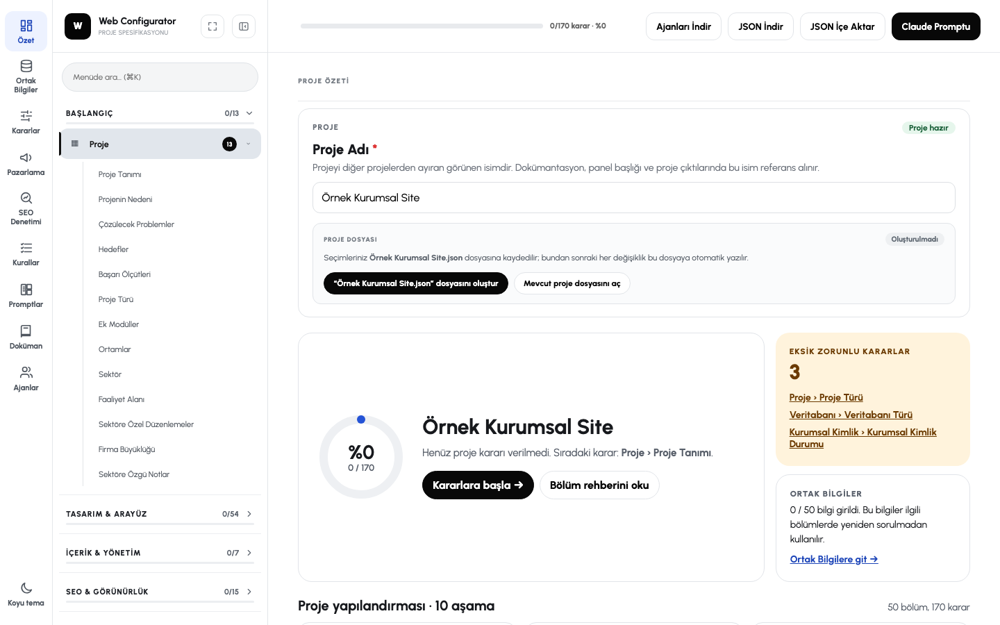
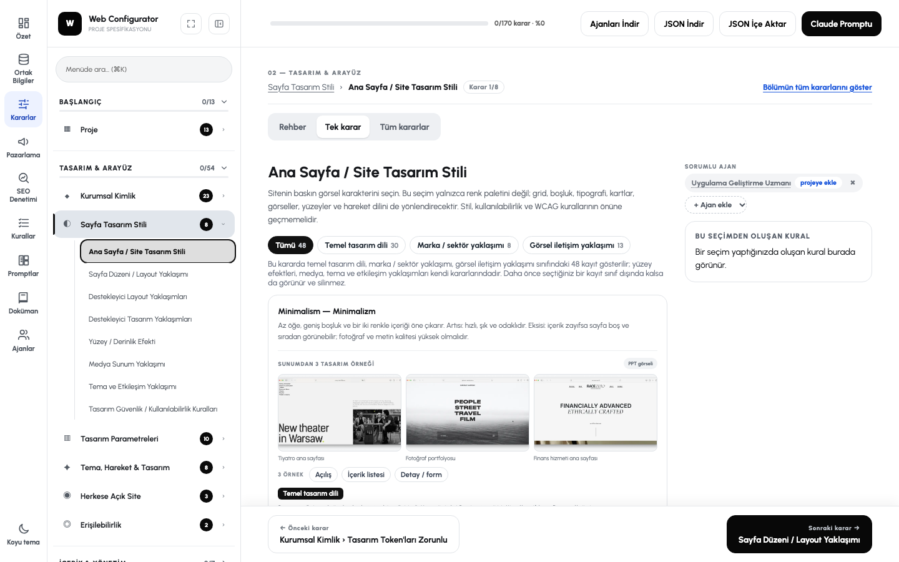
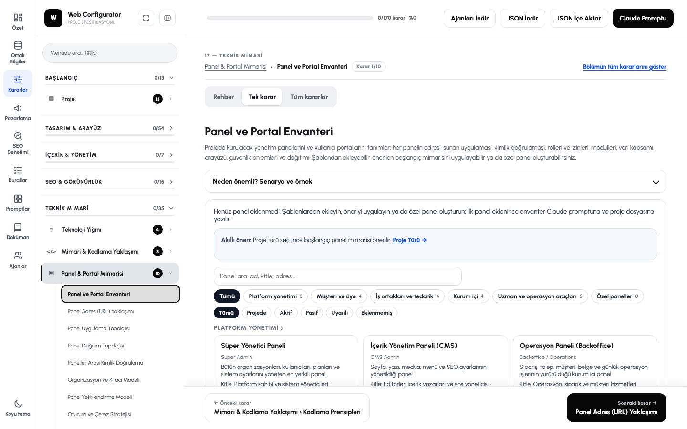
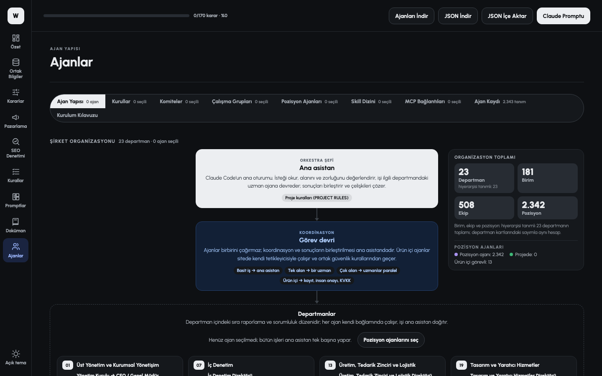

# Cortex — Web Project Configurator

**Canlı demo: [cortex.onurkenar.com](https://cortex.onurkenar.com/)**

Yeni bir web projesine başlamadan önce teknik, tasarım, içerik, güvenlik ve pazarlama kararlarını adım adım vermenizi sağlayan bir araç. Verdiğiniz kararları bir yapay zekâ kodlama ajanının (Claude Code, claude.ai) uyacağı **bağlayıcı proje kurallarına**, **fazlara bölünmüş bir talimat dosyasına** ve **hazır ajan / skill dosyalarına** çevirir.

Teknik bilgi gerekmez: her seçeneğin kartında ne zaman doğru seçim olduğunu anlatan bir senaryo ve sitede nasıl görüneceğini gösteren bir örnek bulunur. Arayüz Türkçedir.

[](https://cortex.onurkenar.com/)

---

## İçindekiler

- [Ne işe yarar?](#ne-işe-yarar)
- [Hızlı başlangıç](#hızlı-başlangıç)
- [Adım adım kullanım](#adım-adım-kullanım)
- [Çıktılar](#çıktılar)
- [Çıktıları Claude ile kullanmak](#çıktıları-claude-ile-kullanmak)
- [Verileriniz nerede saklanır?](#verileriniz-nerede-saklanır)
- [Tarayıcı desteği](#tarayıcı-desteği)
- [Sık sorulanlar](#sık-sorulanlar)
- [Geliştiriciler için](#geliştiriciler-için)

---

## Ne işe yarar?

Bir web projesini yapay zekâya yaptırırken en sık yaşanan sorun, ajanın sizin vermediğiniz kararları kendi başına vermesidir: hangi veritabanı, hangi tasarım dili, hangi güvenlik önlemleri, KVKK metinleri nerede, panel hangi adreste… Cortex bu kararları sizden **önceden ve tek tek** alır, sonra ajana "bunlara uy" diye verir.

| Modül | İçerik |
|---|---|
| **Proje Kararları** | 10 grupta 50 bölüm, 170 karar: Başlangıç, Tasarım & Arayüz, İçerik & Yönetim, SEO & Görünürlük, Teknik Mimari, Sunucu & Altyapı, Güvenlik & Gizlilik, Performans & Test, Geliştirme Süreci, Yayın & Operasyon |
| **Ortak Bilgiler** | Birden çok bölümde kullanılan bilgileri bir kez girersiniz: kimlik ve kurum, iletişim ve adres, işletme ve pazar, marka renkleri ve fontları, eylem çağrıları (CTA), dijital hesaplar, rakipler, hedef sorgular |
| **Pazarlama Kararları** | 31 bölüm: strateji, hedef kitle, içerik, satış dokümanları (sunum, teklif, tanıtım föyü), kanallar (sosyal medya, e-posta, SMS, podcast, basın), reklam (Google, Meta, LinkedIn, TikTok), ölçüm, süreç ve ekip, içerik planı dosyası |
| **SEO Denetimi** | Yayındaki bir siteyi denetlemek için 10 bölüm: tarama, sayfa içi SEO, yapısal veri, performans, uluslararası / yerel SEO, AI arama (GEO) görünürlüğü, otorite, ölçüm. Seçimlerden hazır bir denetim promptu üretir |
| **Tasarım kütüphanesi** | 61 tasarım stili ve 20 sayfa düzeni; her biri için örnek görseller, büyütülebilir önizlemeler (masaüstü / tablet / mobil, açık / koyu), canlı site örnekleri, CSS token'ları ve tasarım şartnamesi |
| **Panel & Portal Mimarisi** | 21 hazır panel şablonu (süper yönetici, CMS, müşteri, bayi, finans, destek…) ve sınırsız özel panel: adres, roller ve izin matrisi, modüller, veri izolasyonu, güvenlik |
| **Ajanlar** | 23 departmanlı bir şirket şeması ve 2.342 pozisyon ajanı; kurullar, komiteler, çalışma grupları, skill dizini (3.394 eklenti), 1.062 MCP bağlantısı ve kurulum kılavuzu |
| **Hazır Prompt Kütüphanesi** | Tekrar kullanılabilir geliştirme modülleri (ör. *Erişilebilirlik — WCAG 2.2 AA*, *KVKK / GDPR & Çerez Yönetimi*); seçtiklerinizi bağımlılıklarıyla tek bir geliştirme talimatında birleştirir |

---

## Hızlı başlangıç

1. **[cortex.onurkenar.com](https://cortex.onurkenar.com/)** adresini Chrome ya da Edge'de açın. Kurulum ya da üyelik gerekmez.
2. Açılış ekranında **Projeyi başlat**'a basın ve projenize bir ad verin.
3. **"Proje Adı.json" dosyasını oluştur** ile bilgisayarınızda bir proje dosyası oluşturun. Bundan sonraki her değişiklik bu dosyaya kendiliğinden kaydedilir.
4. Sol menüden kararları verin. **Ortak Bilgiler** ile başlamanızı öneririz: buraya girdiğiniz marka adı, renkler ve iletişim bilgileri diğer bölümlerde yeniden sorulmaz.
5. Bitince üst şeritteki **Claude Promptu**'na basın, `CLAUDE-TALIMATLARI.md` dosyasını indirin ve kısa başlatma promptunu Claude'a verin.

---

## Adım adım kullanım

### 1. Proje oluşturun

Proje adı yazılmadan ve (destekleyen tarayıcılarda) proje dosyası oluşturulmadan seçim yapılamaz; böylece kararlarınız kaybolmaz. Kararlara önce göz atmak isterseniz açılış ekranında **Önce kararlara göz at**'ı seçebilirsiniz.

Kayıtlı bir projeye dönmek için **Proje dosyasını aç**'ı kullanın.

### 2. Ekranı tanıyın

- **Soldaki modül şeridi:** Özet, Ortak Bilgiler, Kararlar, Pazarlama, SEO Denetimi, Kurallar, Promptlar, Doküman, Ajanlar.
- **Karar menüsü:** bölümler gruplara ayrılmıştır. Verilmiş kararlar yeşil ✓ ile işaretlenir, grup başlıklarında ilerleme çubuğu bulunur. **⌘K / Ctrl+K** menü aramasını açar; arama Türkçe karakterlere duyarsızdır ("cerez" yazınca "Çerez" bulunur).
- **Üç görünüm:** **Rehber** bölümün amacını, seçim ölçütlerini, dikkat edilecekleri ve kaynakları anlatır. **Tek karar** yalnız bir kararı gösterir, alttaki *Önceki / Sonraki karar* düğmeleriyle ilerlersiniz. **Tüm kararlar** bölümün bütün kararlarını tek sayfada gösterir.



### 3. Kararları verin

- Her kartta **Neden önemli? Senaryo ve örnek** açılır alanı bulunur.
- Seçtiğiniz kartın yanında **Bu seçimden oluşan kural** ve kararın **sorumlu ajanı** görünür.
- Bazı kararlar yalnız ilgili seçimden sonra açılır (ör. parola kuralları, parolalı bir giriş yöntemi seçilince). Gizlenen kararlarınız silinmez.
- Önceki bir seçiminizle uyumsuz bir durum olursa kartların üstünde bir **öneri** belirir. Öneri yalnız **Öneriyi uygula**'ya bastığınızda uygulanır, kararlarınız kendiliğinden değişmez.
- Zorunlu kararlar yıldızla işaretlidir. **Özet** sayfası eksik zorunlu kararları ve kaldığınız yeri gösterir.

### 4. İsteğe bağlı modüller

- **Panel & Portal Mimarisi** (Teknik Mimari grubunda): projede yönetim paneli ya da kullanıcı portalı varsa envantere şablondan ekleyin veya özel panel oluşturun. Her panelin adresi, rolleri, izinleri ve güvenlik önlemleri ayrı sekmelerde düzenlenir.

  

- **Pazarlama Kararları** ve **SEO Denetimi**: sol alttaki *Pazarlama* başlığının altındadır. Proje kararlarından bağımsız ilerler ve kendi çıktılarını üretir.
- **Hazır Prompt Kütüphanesi** (*Promptlar*): hazır modülleri inceleyin, kendi modüllerinizi ekleyin, seçtiklerinizi tek bir `GELISTIRME-TALIMATI.md` dosyasında birleştirin. Kütüphane projeden bağımsızdır ve tarayıcınızda saklanır.

### 5. Ajanları seçin

**Ajanlar** sayfası projeyi bir şirket organizasyonu gibi kurar: en üstte işi dağıtan ana asistan, altında 23 departman, birimler, ekipler ve pozisyonlar. Her pozisyonun bir ajanı vardır. Projeye eklediğiniz ajanlar yeşil görünür; Claude promptuna ve indirilecek ajan dosyalarına girer.



Sekmeler:

- **Pozisyon Ajanları:** ajan seçimi, arama, ajanın görevi, araçları ve bağlı skill'leri.
- **Skill Dizini:** proje skill'leri, Anthropic'in açık kaynak skill'leri ve claude.ai skill dizini tek yerde.
- **MCP Bağlantıları:** Claude'a bağlanabilen uygulamalar (Anthropic Connectors Directory). Seçtiklerinizden `.mcp.json` dosyası indirilir.
- **Kurullar, Komiteler, Çalışma Grupları:** departmanlar arası karar süreçleri. Seçtikleriniz kurallara eklenir; ana asistan bu konularda karar vermez, gerekçeli öneriyi size sunar.
- **Kurulum Kılavuzu:** seçtiğiniz ajan, skill ve bağlantıları Claude Code'a ya da claude.ai'a nasıl kuracağınızı projenize göre adım adım anlatır.

---

## Çıktılar

| Çıktı | Nerede | Ne içerir |
|---|---|---|
| **Proje Kuralları** | *Kurallar* sayfası | Bütün kararlarınızın bölüm bölüm tek bir kural setinde toplanmış hâli |
| **`CLAUDE-TALIMATLARI.md`** | Üst şerit › **Claude Promptu** | Kararlarınızı fazlara bölen talimat dosyası: içindekiler, çalışma şekli, Faz 0 (inceleme ve plan), uygulama fazları, doğrulama ve teslim fazı, ekler |
| **Başlatma promptu** | Aynı panel | Claude'a talimat dosyasını fazlar hâlinde, her faz sonunda onayınızı alarak uygulatan kısa metin |
| **Tam prompt** | Aynı panel › *Tam promptu tek parça kopyala* | Bütün kuralların tek parça metni |
| **Ajan ve skill zip'i** | Üst şerit › **Ajanları İndir** | `.claude/agents/*.md` ve `.claude/skills/<ad>/SKILL.md` dosyaları |
| **`.mcp.json`** | Ajanlar › MCP Bağlantıları | Seçtiğiniz MCP sunucularının yapılandırması (gizli değerler `${DEGISKEN}` olarak) |
| **JSON dosyaları** | Üst şerit › **JSON İndir** | *Proje Kararları*, *Pazarlama Kararları* ve *SEO Denetimi* ayrı dosyalar olarak, ayrıca tam yedek |
| **Denetim promptu** | SEO Denetimi › Denetim Raporu & Prompt | Yayındaki siteyi denetletmek için hazır prompt (`.md`) |
| **Tasarım çıktısı** | Tasarım Parametreleri | Tasarım yapılandırması (JSON) ve CSS token'ları |

İndirmeden önce paneller eksik kararlarınızı listeler ve **Eksik kararlara git →** ile sizi oraya götürür.

---

## Çıktıları Claude ile kullanmak

### Claude Code

1. **Ajanları İndir** ile aldığınız zip'i proje kök klasörüne açın (`.claude/` gizli bir klasördür):
   ```sh
   unzip "Proje Adı-claude-ajan-skill.zip" -d /proje/klasoru
   ```
2. `CLAUDE-TALIMATLARI.md` dosyasını proje köküne koyun.
3. MCP bağlantısı seçtiyseniz `.mcp.json` dosyasını da proje köküne koyun ve istenen ortam değişkenlerini tanımlayın.
4. Claude Code'u proje klasöründe başlatın; `/agents` ve `/mcp` ile ajanların ve bağlantıların yüklendiğini kontrol edin.
5. **Başlatma promptunu** yapıştırın. Claude önce Faz 0'da kodu inceleyip plan sunar, sonra fazları sırayla uygular. Her faz sonunda rapor verir ve siz **"devam"** demeden sonraki faza geçmez. İlerleme `CLAUDE-ILERLEME.md` dosyasına yazılır; yeni bir oturumda **"kaldığın yerden devam et"** demeniz yeterlidir.

### claude.ai

`CLAUDE-TALIMATLARI.md` dosyasını bir projeye ya da sohbete ekleyin ve başlatma promptunu gönderin. Skill'leri ve bağlayıcıları ekleme adımları uygulamadaki **Ajanlar › Kurulum Kılavuzu** sekmesinde, seçimlerinize göre anlatılır.

---

## Verileriniz nerede saklanır?

Cortex tek bir statik HTML sayfasıdır, sunucu tarafı yoktur. **Seçimleriniz hiçbir sunucuya gönderilmez.**

- **Tarayıcınızda:** seçimler bu tarayıcının yerel deposunda otomatik saklanır. Başka bir tarayıcıda ya da cihazda görünmez; tarayıcı verilerini silerseniz bu kopya da silinir.
- **Proje dosyanızda:** Chrome ve Edge'de oluşturduğunuz `<Proje Adı>.json` dosyasına her değişiklik yarım saniye içinde yazılır. Sayfayı yeniden açtığınızda tarayıcı yazma iznini yeniden sorabilir.
- **Tek dış bağlantı:** tasarım önizlemesinde marka fontunu göstermeyi seçerseniz font Google Fonts'tan yüklenir. Canlı site örnekleri ve kaynak bağlantıları yalnız tıkladığınızda yeni sekmede açılır.

Projenizi başka bir bilgisayara taşımak ya da paylaşmak için **JSON İndir › tam yedek** dosyasını kullanın ve **JSON İçe Aktar** ile yükleyin.

---

## Tarayıcı desteği

| Tarayıcı | Durum |
|---|---|
| Chrome, Edge (masaüstü) | Tam destek: proje dosyasına otomatik kayıt dahil |
| Firefox, Safari | Çalışır; proje dosyası yerine tarayıcı deposu ve JSON İndir / İçe Aktar kullanılır |
| Mobil | Çalışır; menü çekmece olarak açılır. Uzun karar setleri için masaüstü önerilir |

Açık ve koyu tema desteklenir (sistem tercihinize uyar, sol alttan değiştirilebilir).

---

## Sık sorulanlar

**Bütün kararları vermek zorunda mıyım?**
Hayır. Yalnız zorunlu kararlar (yıldızlı) önemlidir. Vermediğiniz kararlar kurallara girmez; ajan o konularda size sorar ya da varsayılan iyi uygulamayı izler.

**Kararlarımı sonradan değiştirebilir miyim?**
Evet. Kurallar, talimat dosyası ve ajan dosyaları her değişiklikte yeniden üretilir. Güncel dosyayı yeniden indirip projeye koyun.

**Hukuki metinler (KVKK, çerez, mesafeli satış) hazır mı geliyor?**
Araç bu metinlerin nerede, nasıl ve hangi kurallarla hazırlanacağını belirler, KVKK / çerez modülü de kapsamlı bir geliştirme promptu içerir. Ancak üretilen içerik bir başlangıç noktasıdır; yayından önce avukat ya da veri koruma sorumlusu tarafından incelenmelidir.

**Sadece Claude ile mi çalışır?**
Çıktılar Claude Code ve claude.ai biçimine göre hazırlanır (`.claude/agents`, `SKILL.md`, `.mcp.json`). `CLAUDE-TALIMATLARI.md` ve proje kuralları düz Markdown olduğu için başka yapay zekâ kodlama araçlarına da talimat olarak verilebilir.

---

## Geliştiriciler için

Uygulama bilerek **tek dosyadır**: [`web-proje-gelistirme.html`](web-proje-gelistirme.html). Vanilla JavaScript ile yazılmıştır; derleme adımı ya da bağımlılık yoktur. Dosyayı tarayıcıda doğrudan açarak çalıştırabilirsiniz.

### Klasör yapısı

```
web-proje-gelistirme.html   Uygulamanın tamamı (CSS, JS, veri)
CLAUDE.md                   Mimari, veri yapısı ve düzenleme kuralları (ayrıntılı geliştirici notları)
docs/
  MASTER-PROMPT.md          Ürün spesifikasyonu ve geliştirme ilkeleri
  YOL-HARITASI.md           Fazlar, yapılanlar, açık işler
  organizasyon/             Departman, kurul, komite, çalışma grubu kaynak JSON'ları ve dönüştürücü betikler
  mcp/  skills/             MCP kataloğu ve skill dizini kaynakları, üretici betikler
  ortak-bilgiler/  seo-denetimi/  pazarlama/  panel-portal/  tasarim-stilleri/
                            İlgili modüllerin kaynak verisi ve uygulamaya yazan betikler
  v26/                      Arayüz bloklarının (CSS / JS) kaynak dosyaları
yapi/                       Organizasyon modelinin özgün kaynak dosyaları
Kılavuzlar/                 Pazarlama alanlarının türetildiği kurumsal içerik kılavuzları
yayin/                      cortex.onurkenar.com yayını (Cloudflare Workers)
```

### Önemli kurallar

- Uygulamanın verisi (`const DATA = {…}`) tek satırda ve yaklaşık 20 MB'tır. Bu satırı editörde açmayın; Python'da `json.JSONDecoder().raw_decode` ile okuyun. Verinin büyük bölümü elle yazılmaz, `docs/` altındaki betiklerle kaynak JSON'lardan üretilir.
- Yeni görsel değişiklik yeni bir `<style id="vNN-…">` bloğu olarak eklenir; eski bloklar yeniden yazılmaz.
- Ayrıntılı veri şeması, betiklerin çalıştırılma sırası ve test yöntemi için [CLAUDE.md](CLAUDE.md) dosyasına bakın.

### Yayın

Site Cloudflare Workers üzerinde yayınlanır. Ana sayfa yayın sırasında önceden sıkıştırılır (brotli / gzip) ve küçük bir Worker tarafından ETag ile sunulur.

```sh
cd yayin
npm install
npm run yayinla     # HTML'i kopyalar, .br / .gz ve ETag üretir, wrangler deploy eder
```

Cloudflare'in statik dosya başına sınırı 25 MiB'tır; betik bu sınır aşılırsa durur.

### Üçüncü taraf içerik

- `anthropics/skills` deposundan alınan skill metinleri Apache 2.0 lisanslıdır; Türkçeye çevrilmiş gövdelerin sonunda kaynak ve değişiklik bildirimi bulunur. Word / PDF / PowerPoint / Excel skill'leri özel lisanslı olduğundan yalnız tanıtım ve kurulum komutuyla yer alır.
- MCP ve skill dizini verileri Anthropic'in herkese açık dizinlerinden derlenmiştir; açıklamalar Türkçeye çevrilmiştir.
- Tasarım stillerindeki canlı site örnekleri ilgili sitelere bağlantıdır; ekran görüntüleri ve markalar sahiplerine aittir.
